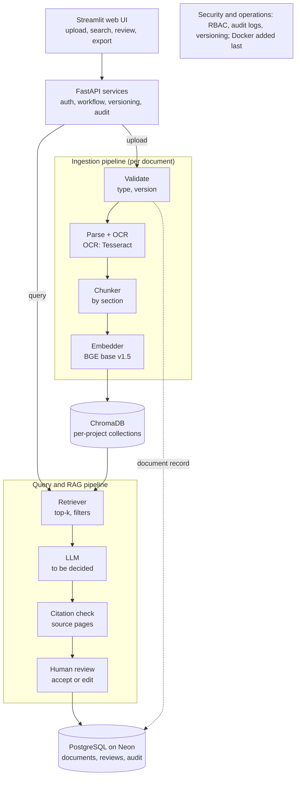
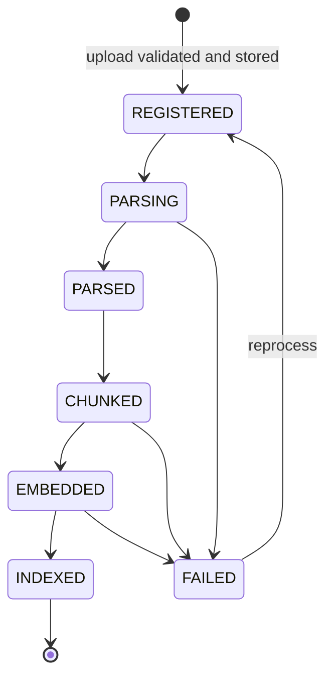
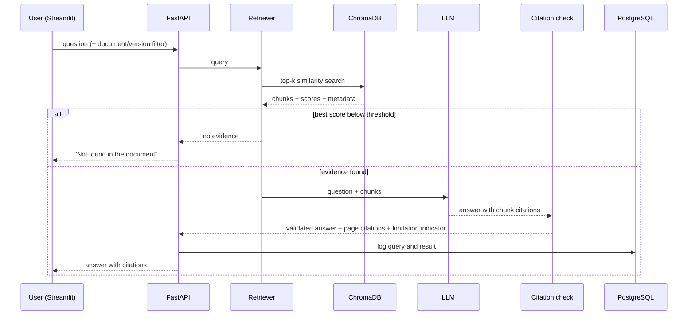

# Architecture Document
## AUTOSAR HLD Document Analysis Assistant

| Field | Details |
|---|---|
| Version | 0.1 (Draft) |
| Date | October 2026 |
| Companion document | `PRD.md` (FR-n references below point to it) |
| Source | *Automotive Engineering AI: Project Case Studies*, Case Study 1 and the common reference architecture |
| Status | Draft for review |

**Labeling convention.** **DECIDED** (confirmed by the project owner), **PROPOSED** (recommended, not yet approved), **OPEN** (undecided), **INFERENCE** (reasoned, not verified).

---

## 1. Architectural Principles

1. **Grounded outputs.** Answers come only from retrieved evidence and carry citations (FR-9, FR-10).
2. **Database storage.** Document files are stored directly in the hosted metadata database (PostgreSQL/Neon) as `LargeBinary` blobs to minimize external dependencies.
3. **Replaceable components.** LLM, parser, and OCR sit behind interfaces because two of them are still undecided.
4. **Human in the loop.** Nothing is treated as trusted until reviewed (FR-13).
5. **Idempotent, auditable pipeline.** Re-running ingestion does not duplicate data; every state change is logged.
6. **Pilot first.** Components are chosen for a two-day pilot and designed so they can scale (PRD §5).

## 2. Technology Stack

| Layer | Technology | Status |
|---|---|---|
| UI | Streamlit | DECIDED |
| API | FastAPI (Python) | DECIDED |
| Vector store | ChromaDB (persistent, local) | DECIDED |
| Structured and Document store | PostgreSQL on Neon | DECIDED |
| Containerization | Docker | DECIDED: deferred, added last |
| OCR | Tesseract (fallback for scanned pages) | PROPOSED |
| Embeddings | `BAAI/bge-base-en-v1.5` via `sentence-transformers` | PROPOSED |
| Document parser | To be decided | OPEN |
| LLM | To be decided | OPEN |

## 3. System Overview



## 4. Component Specifications

### 4.1 Streamlit UI
- Pages: Upload, Documents (status list), Ask (Q&A with citations), Entities (inventory), Review, Export.
- Calls the FastAPI service only; contains no business logic.

### 4.2 FastAPI services

| Endpoint | Purpose | FR |
|---|---|---|
| `POST /documents` | Upload with `version` and metadata; runs ingestion | FR-1–3 |
| `GET /documents` / `GET /documents/{id}` | List documents; show status | FR-3 |
| `POST /documents/{id}/reprocess` | Idempotent re-run of the pipeline | FR-7 |
| `POST /query` | Retrieval-grounded question answering | FR-8–10 |
| `GET /documents/{id}/entities` | Extracted component/interface inventory | FR-11 |
| `GET /documents/{id}/export?format=json\|csv` | Structured export | FR-12 |
| `POST /reviews` | Accept, edit, or reject an item | FR-13 |
| `GET /health` | Liveness and database connectivity | n/a |

### 4.3 Ingestion stage (upload → validation → registration/storage → handoff)

This is the first module to build, after the `documents` table and the config stub.

| Step | Behavior |
|---|---|
| Receive | FastAPI `UploadFile`; stream and validate in-memory to avoid saving to local disk |
| Validate type | Check extension **and** file signature (`%PDF-`); never rely on the extension alone |
| Validate size | Reject files above a configurable limit |
| Validate version | Required version label matching a configured pattern; reject duplicate `(project, document name, version)` |
| Hash | Compute SHA-256 of the content for integrity and duplicate detection |
| Generate ID | UUID for `document_id` |
| Store file | Save the `LargeBinary` file content to the database within the single `REGISTERED` transaction |
| Register | Insert the `documents` row with status `REGISTERED` (single transaction; remove the stored file if the insert fails) |
| Handoff | Enqueue processing for the new `document_id` |

**Handoff boundary (PROPOSED):** ingestion ends when `register_document()` commits the `documents` row with status `REGISTERED` and calls `enqueue_processing(document_id)`. Everything after that call belongs to the parsing stage. The function names are proposals, not existing code.

**Pilot handoff mechanism:** FastAPI `BackgroundTasks`. **INFERENCE:** adequate for one user and a few documents; replace with a proper job queue if processing time or concurrency grows.

**Document status lifecycle**



### 4.4 Parsing and OCR
- **Parser: OPEN.** Candidates listed in the case study: PyMuPDF, pdfplumber, PyPDF. Evaluate on the sample document for heading, table, and page-number fidelity. Check license terms before any enterprise use.
- **OCR: Tesseract (PROPOSED).** Runs only on pages where the parser returns no text. Requires the Tesseract binary installed on the system, plus a Python wrapper. Output is tagged `ocr=true`.
- **Interface (PROPOSED):** `parse(path) -> list[Block]` where each `Block` has `text`, `page`, `section_path`, `block_type` (`text` | `table` | `heading`), and `ocr` flag.

### 4.5 Chunker
- Splits by section boundaries first, then by size.
- **FACT:** `bge-base-en-v1.5` accepts at most 512 tokens, so chunks must fit within that limit.
- Tables are kept as their own chunks (`chunk_type=table`) so they are not cut mid-row.
- Each chunk carries: `chunk_id`, `document_id`, `version`, `page_start`, `page_end`, `section_path`, `chunk_type`.
- Chunk size and overlap are tuned on the benchmark questions (OPEN, PRD §12).

### 4.6 Embedder
- `BAAI/bge-base-en-v1.5` through `sentence-transformers`, with normalized vectors. Fallback: `bge-small-en-v1.5` if CPU speed is a problem.
- BGE documents an optional instruction prefix for retrieval queries; evaluate with and without it.
- The embedding model name is stored with each collection. **Never mix models in one collection**; changing the model requires re-embedding.

### 4.7 Vector store (ChromaDB)
- One persistent collection per project, as the case study requires project separation.
- Chunk metadata stored alongside vectors (fields in §4.5) to support filtering by document and version.
- Configure cosine distance. Verify the setting against the installed ChromaDB version's API, since the configuration mechanism has changed between releases.
- Use the `chunk_id` as the ChromaDB ID so re-embedding the same document overwrites rather than duplicates (idempotency, FR-7).

### 4.8 Retriever
- Embed the query, search top-k with optional filters (document, version), return chunks with scores and metadata.
- A minimum similarity threshold triggers the "not found" path. **OPEN:** the threshold must be calibrated on benchmark questions, not guessed.

### 4.9 LLM gateway
- **LLM is OPEN.** All calls go through a single interface (PROPOSED): `generate(prompt, context_chunks) -> text`, with implementations selectable by config (a local runtime such as Ollama, or an approved hosted API if policy allows).
- Prompt rules: answer only from the supplied chunks; cite chunk IDs; say "not found" if the context is insufficient.
- Repository and document text is treated as untrusted input. Instructions and content are kept separate in the prompt.

### 4.10 Citation validator
- Maps cited chunk IDs back to document, version, and page.
- Rejects or flags any answer whose citations are not in the retrieved set.
- Outputs a limitation indicator (for example "weak evidence") alongside the answer.

### 4.11 Entity extraction (P1)
- Extracts components, interfaces, ports, signals, and dependencies using the LLM over retrieved or section-level chunks, constrained to a defined JSON schema.
- Each item stores its source page and a review status.
- **INFERENCE:** extraction from tables and diagrams will be imperfect; the review step (FR-13) is the control.

### 4.12 Review and audit
- Items and answers move through `PENDING → ACCEPTED | EDITED | REJECTED`.
- Every decision writes an audit record (user, time, before and after values).
- The full review state machine is deferred; the pilot stores decisions only.

## 5. Query Flow



## 6. Data Model (PostgreSQL on Neon)

**PROPOSED** schema sketch (to be finalized when the `documents` table is built):

| Table | Key columns |
|---|---|
| `projects` | `project_id`, `name` |
| `documents` | `document_id` (UUID, PK), `project_id`, `name`, `version`, `status`, `approved_source` (bool), `original_filename`, `file_content` (LargeBinary), `size_bytes`, `sha256`, `uploaded_by`, `uploaded_at`, `error_message`; unique on `(project_id, name, version)` |
| `chunks` | `chunk_id`, `document_id`, `page_start`, `page_end`, `section_path`, `chunk_type`, `ocr` |
| `entities` | `entity_id`, `document_id`, `entity_type`, `name`, `attributes` (JSONB), `source_page`, `review_status` |
| `queries` | `query_id`, `question`, `answer`, `citations` (JSONB), `limitation`, `created_at` |
| `reviews` | `review_id`, `target_type`, `target_id`, `decision`, `old_value`, `new_value`, `reviewer`, `reviewed_at` |
| `audit_log` | `audit_id`, `actor`, `action`, `object_ref`, `created_at` |

Vector data is **not** stored in PostgreSQL. ChromaDB is the only place embeddings live.

**Neon notes**
- Use the SSL-enabled connection string provided by Neon.
- **INFERENCE:** free-tier compute may suspend when idle, causing slow first queries. Add retry logic on connection (PRD risk R-7); verify current behavior in Neon's documentation.
- Access the database through an ORM or driver layer so a local PostgreSQL can be swapped in without code changes.

## 7. Security and Operations

| Concern | Pilot approach | Later |
|---|---|---|
| Data residency | Files and metadata in Neon, embeddings local | Re-assess before real or confidential HLDs |
| Secrets | `.env` file, excluded from version control | Secret manager |
| Access control | Single user, no RBAC (FR-15 deferred) | RBAC, project isolation |
| Audit | `audit_log` and `reviews` tables | Centralized logging |
| Deployment | Run locally (Streamlit + FastAPI + local ChromaDB) | Docker, added last |

## 8. Repository Layout

Per the structure already established for the project:

```
autosar-hld-assistant/
├── docs/          PRD.md, Architecture.md, discovery artifacts
├── data/          uploads/, sample documents
├── src/           api/, ingestion/, parsing/, chunking/, embedding/, retrieval/, llm/, ui/
├── db/            schema, migrations
├── evaluation/    benchmark questions, ground truth, results
├── config/        settings, config stub
└── exports/       generated JSON/CSV
```

The sub-folders under `src/` are a proposal for the pipeline components above.

## 9. Build and Test Order

1. `config` stub and `documents` table.
2. Ingestion (this document §4.3): upload, validation, registration, handoff. Tests: rejected file types, oversized files, duplicate versions, hash integrity, rollback on failed insert.
3. Parsing (after the parser decision), then chunking, embedding, ChromaDB indexing.
4. Retrieval and the LLM gateway, then citation validation and the refusal path.
5. Streamlit UI.
6. Entity extraction, export, review (P1).
7. Evaluation run against benchmark questions; record results including failures.
8. Docker packaging last.

## 10. Architecture Risks and Open Items

| # | Item | Impact | Note |
|---|---|---|---|
| A-1 | LLM undecided | High | Blocks Q&A; decide first |
| A-2 | Parser undecided | High | Drives table and heading quality for all later stages |
| A-3 | Retrieval threshold uncalibrated | Medium | Wrong threshold causes false refusals or ungrounded answers |
| A-4 | BGE vs E5 unvalidated on domain text | Low to medium | Chunking quality likely matters more (INFERENCE) |
| A-5 | BackgroundTasks limits | Low in pilot | Replace with a queue if concurrency grows |
| A-6 | Hosted database vs local-only principle | Medium | Metadata only; re-check policy for confidential data |
| A-7 | Sample document may not represent real HLDs | Medium | Results are demo-level until tested on a real HLD |

## 11. Traceability to Requirements

| Component | Requirements |
|---|---|
| Ingestion (§4.3) | FR-1, FR-2, FR-3 |
| Parsing and OCR (§4.4) | FR-4, FR-5 |
| Chunker (§4.5) | FR-6 |
| Embedder and vector store (§4.6, §4.7) | FR-7 |
| Retriever (§4.8) | FR-8 |
| LLM gateway and citation validator (§4.9, §4.10) | FR-9, FR-10 |
| Entity extraction (§4.11) | FR-11 |
| Export (§4.2) | FR-12 |
| Review and audit (§4.12) | FR-13 |
| Deferred components | FR-14, FR-15 |
